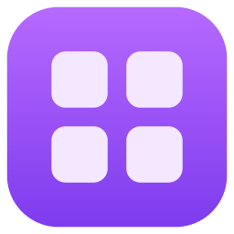

<div align="center">



# G Deck
**A Stream Deck for the 18 G keys on a Corsair K95 RGB. No iCUE, no service, no driver, no network.**

[](https://github.com/elysiummachines/GDeck/actions/workflows/ci.yml)
[](https://github.com/elysiummachines/GDeck/releases)
[](https://github.com/elysiummachines/GDeck/releases)
[](https://www.rust-lang.org)
[](https://www.microsoft.com/windows)
[](#verification)
[](LICENSE)
[](https://github.com/elysiummachines/GDeck/stargazers)

[Features](#features) • [Getting Started](#getting-started) • [Security Model](#security-model) • [Verification](#verification) • [Technical Notes](#technical-notes)

</div>

## Overview

G Deck turns the 18 G keys on an original Corsair K95 RGB (`1b1c:1b11`) into a
Stream Deck. Bind each one to an application, a game, a folder, a note or a
shell command, and press it.

The K95 RGB is discontinued and iCUE no longer supports it. G Deck replaces
the part of that stack you actually wanted, in about 6 MB, with nothing
installed and nothing running as a service.

It is **read only on the keyboard**. The G keys already report on a vendor HID
collection with nothing written to the device, so G Deck opens that pipe and
listens. It never reprograms the keyboard, which is why it can sit alongside
SignalRGB without either one contending for the device.

It **cannot read your typing**. Windows claims keyboard top level HID
collections exclusively, so a user mode program is refused when it tries to
open one. G Deck installs no keyboard hook, for G keys or anything else. This
is a property of how it is built, not a promise, and
[Verification](#verification) is how you check it.

## Features

- **18 keys, mapped how you like.** Launch an application, open a folder or
  document, show a note, or run a shell command.
- **Deck mode.** Hides the editor, fills the screen and fires on tap. Made for
  an external touch display sitting next to the keyboard.
- **Drag to reorder.** Drag one tile onto another and the two swap.
- **Real icons**, pulled from each target through the shell, so a tile looks
  like the thing it launches. Nothing is fetched from the internet, because
  there is no network code.
- **Lives in the tray.** Closing the window hides it; the keys keep working.
- **One instance.** A second launch raises the copy already running and exits,
  so a pinned taskbar button does not pile up keyboard readers.
- **Opt in autostart**, off by default, through the per user Run key only.
- **Access control you can see and edit.** Every live entry on the config
  store, resolved to names, with drift detection and a box for your own
  descriptor.
- **Tamper evident config.** A DPAPI sealed baseline, and a line by line diff
  if the file changed outside the app. Keys stay dead until you confirm it.
- **Zero dependency core.** Every security decision, the parser, the seal and
  the launcher live in a crate with no dependencies at all.
- **Dark and purple, fixed.** One theme, no theme engine to configure.

## How It Works

```
The keyboard, before G Deck exists
  104 normal keys   flag IN_HID       -> Windows keyboard stack -> your apps
  G1 to G18         flag IN_CORSAIR   -> vendor HID collection   -> nobody

  The two paths never meet. G Deck opens only the second one, and the
  second one carries an 18 bit state bitmap and nothing else.

Startup
  claim the single instance name            else tell the running copy, exit
  read config.ini                           refuse the whole file on any error
  check the DPAPI seal                      mismatch -> show the diff, disarm
  apply the access control policy to the store
  open the vendor collection, start the reader thread
  put an icon in the notification area

A key press
  reader thread wakes on the overlapped read, no polling
  decode the report, masked to exactly the 18 mapped bits
  diff against the previous state to get press and release
  hand the key to a worker thread, so a slow command cannot stall the pump
  re-validate the target now, not just when the file was parsed
  CreateProcessW with the absolute path as lpApplicationName
  append what ran to the audit log

Exit
  closing the window hides it; the keys keep working
  Quit on the tray menu removes the icon, waits for the removal, then exits
```

## Getting Started

### Prerequisites

- Windows 10 or 11, x64
- A Corsair K95 RGB, the original 18 G key model (`VID 1B1C`, `PID 1B11`)
- No administrator rights, no driver, no Corsair software
- To build: [Rust](https://rustup.rs) 1.74 or newer and the MSVC toolchain
  (the "Desktop development with C++" workload)

Nothing Corsair-authored is needed at any point. If you use SignalRGB for
lighting, keep it. G Deck never writes to the keyboard, so the two do not
interact.

### Build

```bat
cargo build --workspace --release
```

Produces `target\release\gdeck-ui.exe`, the interface, and
`target\release\gdeck.exe`, a small command line tool for looking at the
device.

There is no resource compiler step and no asset pipeline. The application
icon is drawn in code at seven sizes and written into the executable's
resource section by `build.rs`, which emits the Windows `.res` container
itself.

To check the binaries against the claims this README makes about them:

```powershell
.\.github\scripts\verify-binary.ps1
```

### Usage

Run `target\release\gdeck-ui.exe`. There is no installer and nothing to set
up: click a tile, pick what it should do, and save.

| Key | Effect |
|---|---|
| <kbd>F11</kbd> | Toggle fullscreen |
| <kbd>Esc</kbd> | Leave deck mode |

The command line tool is for inspecting the hardware rather than daily use:

| Command | Effect |
|---|---|
| `gdeck list` | Show the keyboard's HID collections and which ones Windows will let a user mode program open |
| `gdeck watch` | Print G key events until Ctrl+C |
| `gdeck watch 30` | Print G key events for 30 seconds, then stop cleanly |

> [!NOTE]
> Shell commands are **off by default**. Turning them on is a deliberate
> choice in the Security panel. Be aware this is a speed bump rather than a
> boundary: a launch action with arguments can already run anything, which
> the [threat model](docs/THREAT-MODEL.md) says plainly.

### Releasing

Tagging is the whole release process. Pushing a `v*` tag runs
[`release.yml`](.github/workflows/release.yml), which stamps the version into
the workspace manifest, builds, runs the binary checks, and publishes a GitHub
Release carrying the zip and the SHA-256 of each executable:

```bash
git tag -s v0.1.0 -m "G Deck v0.1.0"
git push origin v0.1.0
```

The release notes are that version's section of [CHANGELOG.md](CHANGELOG.md),
read by `changelog-section.ps1`, so the notes and the changelog are the same
text by construction. A tag with no section fails the job rather than
publishing empty notes.

Every push and pull request on `main` runs
[`ci.yml`](.github/workflows/ci.yml): formatting, clippy with warnings as
errors, the test suite, the registry test that is excluded from the default
run, a release build, and the binary checks.

Neither workflow can press a G key. That needs the hardware, so it stays a
local check. What CI does guarantee is that the read only property, the
absence of any networking library and the zero dependency core have not
regressed.

## Configuration

`%LOCALAPPDATA%\GDeck\`, created on first run:

| File | What it is |
|---|---|
| `config.ini` | The 18 bindings. Line based, so a Windows path needs no escaping and round trips exactly as written. |
| `config.seal` | DPAPI sealed copy of the above, for detecting edits made outside the app. |
| `audit.log` | Append only record of what each key ran. Rotates at 1 MB. |
| `notes\` | Quick notes, one file each. |

Every one of them carries a protected descriptor with inheritance severed:

```
Directory:  O:<SID>D:PAI(A;OICI;FA;;;<SID>)(A;OICI;FA;;;SY)
File:       O:<SID>D:PAI(A;;0x1301BF;;;<SID>)(A;;FA;;;SY)
Audit log:  O:<SID>D:PAI(A;;0x13019D;;;<SID>)(A;;FA;;;SY)
```

Owner and SYSTEM, nothing else. `BUILTIN\Administrators` can be added from the
Security panel and is off by default. The audit log mask withholds
`FILE_WRITE_DATA`, so entries cannot be rewritten in place, while keeping
`DELETE` so the log can be rotated.

There is deliberately no `G:` component. The primary group on a Windows file
object is a vestigial field nothing here reads, and claiming a value we never
write made drift detection report a false positive on every run.

## Security Model

The full version is in [docs/THREAT-MODEL.md](docs/THREAT-MODEL.md), which
lists each actor alongside what they could already do before G Deck existed,
because a defence only counts if it stops someone doing something otherwise
out of reach. The short version:

- **No elevation, ever.** No service, no driver, no scheduled task, no
  elevated helper. Autostart is the per user Run key or nothing.
- **No network.** The import table contains no `ws2_32`, `winhttp`, `wininet`,
  `urlmon` or `dnsapi`. No update check, no telemetry, no cloud profiles.
- **No HID writes.** Six `Get` calls and nothing else.
- **No keyboard hook.** The thing most "macro key" tools do, and the reason
  they can see everything you type.
- **Process creation** through `CreateProcessW` with the absolute path as
  `lpApplicationName`, so Windows never searches `PATH` and the unquoted path
  problem does not arise rather than being mitigated.
- **Autostart is quoted.** Unquoted, a path containing a space lets Windows
  try shorter prefixes first, which is the same defect as the unquoted service
  path problem.
- **Targets are re-validated at press time**, not only when the file was
  parsed.

And what it does **not** do, stated here rather than buried:

- It does not stop a local administrator or SYSTEM. They can take ownership
  and rewrite any descriptor. The optional Administrators entry is convenience,
  not protection.
- It does not stop malware running as you. That holds your token, so it can
  rewrite the config and call DPAPI to re-seal it and hide the edit. The seal
  is tamper evidence against an offline or cross-user edit, not against this.
- Shell actions being off by default is not a boundary, for the reason given
  above.

## Project Structure

```
GDeck/
├── crates/
│   ├── gdeck/              # Core. Zero dependencies.
│   │   └── src/
│   │       ├── ffi.rs          # Every Win32 entry point, declared by hand
│   │       ├── device.rs       # HID enumeration
│   │       ├── reader.rs       # Overlapped read, cancellable without polling
│   │       ├── keys.rs         # The empirically captured bit table
│   │       ├── config.rs       # Line based parser, target validation
│   │       ├── security/       # DACL policy, SDDL, drift detection
│   │       ├── integrity.rs    # DPAPI seal and line diff
│   │       ├── audit.rs        # Append only log
│   │       ├── actions/        # Launch, open, note, shell
│   │       └── main.rs         # gdeck list / watch
│   ├── gdeck-ui/           # Interface, the only crate with dependencies
│   │   ├── build.rs            # Writes the icon's .res container by hand
│   │   ├── assets/             # Inter, two static weights, with its licence
│   │   └── src/
│   │       ├── iconart.rs      # The mark, drawn in code at any size
│   │       ├── theme.rs        # Palette and font loading
│   │       ├── tray.rs         # Notification icon on its own message window
│   │       ├── single_instance.rs
│   │       ├── autostart.rs
│   │       └── main.rs         # Grid, editor, deck mode, security panel
│   └── probe/              # The Phase 0 hardware probe, kept for reproducing
├── docs/
│   ├── THREAT-MODEL.md
│   └── PHASE0-FINDINGS.md
├── scripts/
│   └── exit-matrix.ps1     # Every way it stops, and what each leaves behind
└── .github/
    ├── scripts/            # verify-binary, stamp-version, changelog-section
    └── workflows/          # ci.yml, release.yml
```

## Verification

| Checked | Result |
|---|---|
| Networking libraries imported | **none**, out of 24 DLLs |
| HID imports | **6, all reads**: `HidD_GetHidGuid`, `HidD_GetAttributes`, `HidD_GetPreparsedData`, `HidD_FreePreparsedData`, `HidD_GetProductString`, `HidP_GetCaps` |
| `HidD_Set*`, `DeviceIoControl`, Win32 `WriteFile` | absent (`NtWriteFile` is present and is the standard library's) |
| Core crate dependencies | **0**, verified by `cargo tree -p gdeck` |
| Tests | 70 passing, plus one excluded by default that writes to the registry and puts it back |
| Lints | clean at `clippy --workspace --all-targets -- -D warnings` |
| Binaries | `gdeck-ui.exe` about 5.9 MB, `gdeck.exe` about 0.3 MB |
| Memory, measured | 40 to 46 MB private working set, 70 to 76 MB total working set |
| Access control on disk | matches policy, cross-checked with `icacls` rather than our own read back |
| Exit paths | 6 of 6 clean, see `scripts/exit-matrix.ps1` |
| Keyboard write surface | none, asserted on every build by `verify-binary.ps1` |

Run the checks yourself:

```powershell
.\.github\scripts\verify-binary.ps1
```

```powershell
.\scripts\exit-matrix.ps1
```

```bash
cargo tree -p gdeck
```

```bash
icacls %LOCALAPPDATA%\GDeck
```

The memory figures are two different measurements and are not
interchangeable. Task Manager's Memory column is the private working set, 40
to 46 MB here. PowerShell's `WorkingSet64` is the total, 70 to 76 MB, because
it also counts pages shared with other processes such as the GPU driver.
Hiding the window reduces neither; both rise by about 3 MB.

## Technical Notes

<details>
<summary><b>What the hardware probe established</b></summary>

<br>

The full write up is in [docs/PHASE0-FINDINGS.md](docs/PHASE0-FINDINGS.md),
including the four defects found in the probe itself before any of its results
were trusted.

The K95 RGB exposes three vendor defined collections alongside the normal
keyboard collection. Windows refuses a user mode program the keyboard ones
outright with `ACCESS_DENIED`, which is the measurement behind the claim that
this program cannot read your typing.

The G keys report on `0xFFC0/0x0002` as a **state bitmask**, not an event
stream: report ID `0x03`, with the 18 bits spread across bytes 16 to 18.
Decoding masks to exactly those bits, because the six unmapped bits in byte 17
are almost certainly the M keys and the brightness key, and must not leak
through as a G key.

The single most useful finding was that **the G keys already emit with nothing
written to the device**, and keep emitting with SignalRGB's service stopped and
no SignalRGB process running. That deleted a whole section of the original
plan: there is no routing to configure, so there is no device state to restore
on exit, crash or sign out, and nothing for a watchdog to clobber.

This matches the ckb-next source, which rewrites every key back to `IN_HID`
when shutting down so the G keys do not freeze. That only makes sense if the
vendor pipe is where they live by default.

</details>

<details>
<summary><b>Why the icon is generated rather than shipped</b></summary>

<br>

Windows reads an executable's icon from its resource section. Without one,
Explorer, the taskbar and Alt Tab all show the generic document icon no matter
what the running window does.

The usual way to get a resource section is `rc.exe` from the Windows SDK, or a
crate that shells out to it. Neither is used here. The `.res` container is a
short, documented format, so [`build.rs`](crates/gdeck-ui/build.rs) writes one
directly and hands it to the linker, which accepts `.res` files as input.

The build stays a plain `cargo build`, nothing is added to the dependency
tree, and the artwork stays readable Rust in
[`iconart.rs`](crates/gdeck-ui/src/iconart.rs) rather than a checked in binary.
The same function feeds the executable's icon, the window's and the tray's, so
the three cannot drift apart.

</details>

<details>
<summary><b>Why the typeface is embedded</b></summary>

<br>

egui rasterises glyphs into a texture atlas with grayscale coverage and no
hinting, while Windows draws its own text with ClearType and hinted outlines.
That gap lives in the renderer and no setting closes it.

Segoe UI assumes hinting and thins out without it. Inter is drawn to render
well unhinted, which is exactly the condition egui imposes, so two static
weights are embedded. Static rather than the single variable file, because the
rasteriser uses a variable font's default instance and cannot reach the
semibold axis.

That is 0.79 MB of the binary. Embedding also means the interface looks the
same on a machine with neither font installed. The monospace face is still
read from the system, Cascadia Mono with Consolas behind it, because it
carries key ids and paths only.

</details>

<details>
<summary><b>The notification icon runs its own window</b></summary>

<br>

A tray icon needs a window procedure to receive its callback messages, and
winit owns the one belonging to the app window. So the tray runs a message
only window of its own on a dedicated thread.

Closing the app window sends `CancelClose` and hides it instead of exiting.
That only happens when the tray icon exists: if it could not be created,
hiding would leave a process with no window and no icon, reachable only
through Task Manager.

On a graceful quit the icon is removed **before** the process exits, because
the drop waits for the removal to complete, bounded so a wedged message loop
delays the exit rather than preventing it. Without that wait the process can
die first and leave a dead icon in the tray until something hovers over it.

</details>

## Known Limits

- **One keyboard model.** The original K95 RGB, `1b1c:1b11`. The bit table was
  captured from real hardware and nothing else has been tested. The K95
  Platinum has six G keys and a different report layout.
- **The 18 G keys only.** Not M1, M2, M3, MR, the brightness key or the volume
  wheel. Decoding deliberately masks them out.
- **Lighting is somebody else's job.** No LED code at all. SignalRGB owns the
  device's lighting and G Deck does not contest it.
- **One profile.** No profile banks, no per application switching.
- **Text rendering will not match native Windows text** at 100% display
  scaling, for the renderer reasons above. On a scaled display it looks
  markedly better.

## Contributing

Branch naming, commit style, what CI asserts on every change and the six
things this project will not take are in
[CONTRIBUTING.md](CONTRIBUTING.md).

## License

MIT. See [LICENSE](LICENSE).

The embedded Inter typeface is under the SIL Open Font License 1.1, and its
licence travels with it in
[crates/gdeck-ui/assets/Inter-LICENSE.txt](crates/gdeck-ui/assets/Inter-LICENSE.txt).

The binary carries egui's fallback fonts as well. They are compiled in by the
`default_fonts` feature, kept on purpose so there is always a working typeface
even when the system font cannot be read. Three of the five survive the link,
established by searching the built executable for each font file's own header
rather than by reading the dependency list:

| Font | Bytes in `gdeck-ui.exe` | Licence |
|---|---|---|
| `Ubuntu-Light.ttf` | 361,676 | Ubuntu Font Licence 1.0 |
| `Hack-Regular.ttf` | 309,408 | MIT, with public domain DejaVu work |
| `egui-icons.ttf` | 3,484 | MIT, a subset of emoji-icon-font |

`NotoEmoji-Regular.ttf` and `emoji-icon-font.ttf` are not in the binary. Every
one of these licence texts ships in the `fonts` folder of the
`epaint_default_fonts` crate.
